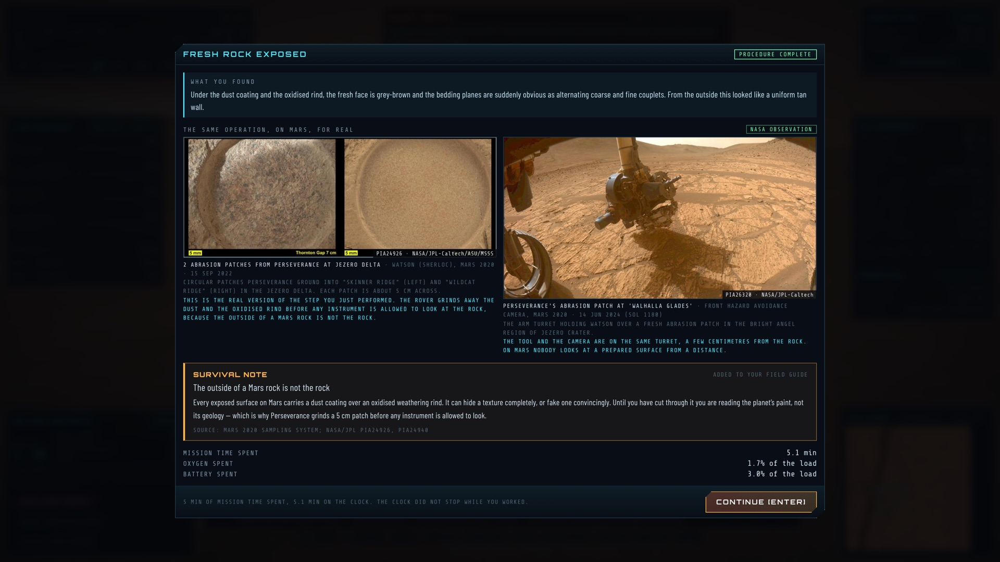
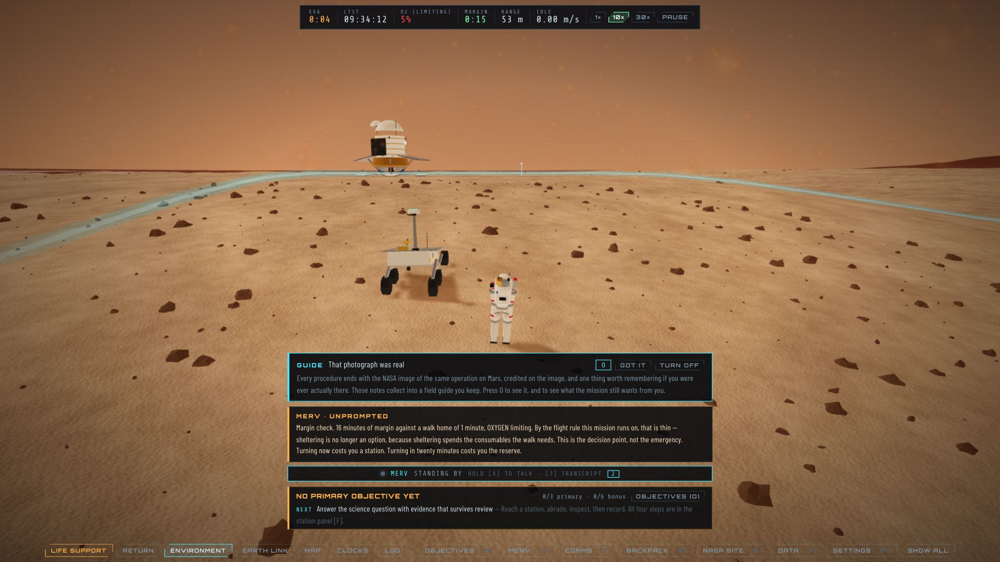

# JACK: Marswalk

**A playable Mars EVA planning and field-science simulation, built on NASA open data.**
NASA Space Apps Challenge 2026.

> Plan a route across real NASA Mars data, walk it in a pressure suit, make the
> observations, and get the astronaut home with the science.

---

## The one-sentence pitch

JACK turns NASA Mars data into a playable Marswalk: plan a route, make field
observations, and get the astronaut back with the science — while Earth is
eleven light-minutes away and cannot answer in time.

## Why this exists

Every public picture of Mars exploration is a rover. The hard part of putting a
*person* on Mars is not the landing, it is the eight hours after the hatch opens:
a finite backpack, a finite sol, terrain nobody has ever walked, weather that
takes your visibility and your power rather than your footing, and a mission
control that is a light-hour round trip away from being any help at all.

JACK makes that tradeoff the whole game. You choose a route knowing what it
costs. You decide, alone, whether to work the third station or turn for the
lander. The debrief tells you what you actually learned and what it cost.

---

## Play it

```bash
npm install
npm run dev        # http://localhost:5173
```

Production build:

```bash
npm run build
npm run preview
```

On the title screen, press **Enter** to start the briefing or **?** to show the
controls and mission rules. The title screen scrolls on short and narrow
displays, keyboard focus is outlined, and system reduced-motion preferences are
respected.

Single-player remains a static site — the `dist/` folder deploys to Vercel,
Netlify, GitHub Pages or any static host with no server, no API keys and no
build-time secrets. That includes MERV, the rover companion: he answers, cites
his sources and speaks aloud with nothing configured. Multiplayer is an optional
Render WebSocket service; the game falls back to the complete local mission when
it is absent. A Deepgram key is an optional upgrade to MERV's voice, never a
requirement — see [MERV, the rover companion](#merv-the-rover-companion).

### Deploy

`netlify.toml` and `vercel.json` are committed, so either platform needs no
configuration: point it at the repo and it builds. For GitHub Pages, run
`npm run build` and publish `dist/` — `vite.config.ts` sets `base: './'` so the
app works from a subpath as well as a domain root.

The single-player runtime network calls are to `trek.nasa.gov` (basemap and HiRISE/CTX tiles),
`flagcdn.com` (flag images) and Google Fonts. All three fail gracefully: the map
falls back to a clearly labelled schematic, flags fall back to a drawn
placeholder, and the fonts fall back to system stacks. The simulation itself
remains local unless the player explicitly creates or joins a multiplayer room.

One more is *optional*: if you configure Deepgram, MERV's speech recognition and
synthesis go to `api.deepgram.com`. Configure nothing and he still talks — see
[MERV, the rover companion](#merv-the-rover-companion) below.

### Multiplayer on Render

Multiplayer supports full two-person surface co-op. **EV-1** owns the authoritative
mission clock, science procedures, shared life support and outcome. **EV-2** opens
the same URL on another computer, joins the same 3D terrain, and walks independently
with their own camera and controls. Each client streams a compact pose at 10 Hz;
the other astronaut is interpolated between updates, while Render clamps coordinates,
rate-limits updates and rejects impossible movement. **HABCOM** remains available on
phones and tablets with telemetry plus `GO`, `HOLD` and `RETURN` recommendations.

A room holds **five**: EV-1, EV-2 and up to three HABCOM stations. Keeping shared
science authoritative on EV-1 prevents two browsers from completing the same core,
cache or ingress procedure twice while still allowing both astronauts to explore
the surface together.

**There is no sign-up, and there are no accounts.** Every visitor is handed a
throwaway identity the moment the page loads — random bytes and a readable
callsign like `CREW-7Q4`, kept in `sessionStorage` and gone when the tab
closes. It authorises nothing. Its only job is to let a room tell three
situations apart: a new person who needs a seat, the same person coming back
after a refresh or a dropped connection, and a second tab on the same machine,
which is how almost everybody tests a multiplayer build.

Without it the server could only guess, and it guessed wrong in the most
visible way: after a refresh your own dead socket still held your seat, so
rejoining reported the station as already occupied. Now the first question the
room asks is "is this the same person", and capacity is only consulted after
that. Storage is `sessionStorage` rather than `localStorage` on purpose —
`localStorage` is shared between tabs, so two tabs would carry one identity and
the second would evict the first.

`render.yaml` provisions one paid Node Web Service that builds and serves `dist/`,
accepts the crew link on `/ws`, exposes `/health`, and optionally mints 60-second
Deepgram tokens at `/api/deepgram-token`. Connect a Render Blueprint to this
repository. `DEEPGRAM_API_KEY` is optional; add it manually in the Render
dashboard to upgrade MERV's voice, or omit it to keep the local voice tier.

Room state is intentionally short-lived and held by the single service instance:
empty rooms expire after 30 minutes, and a service deploy ends active sessions.
That keeps the mission independent of a database and avoids retaining player
telemetry after the session. Identities are never stored server-side beyond the
life of the room.

The Render-hosted frontend discovers its own secure WebSocket endpoint. To make
the existing GitHub Pages deployment use the same service:

1. Deploy the Render Blueprint and copy its `https://…onrender.com` URL.
2. Change the scheme to `wss://` and append `/ws`.
3. In GitHub, open **Settings → Secrets and variables → Actions → Variables**.
4. Add `VITE_MULTIPLAYER_URL=wss://your-service.onrender.com/ws`.
5. Re-run **Deploy GitHub Pages** or push a commit.

The endpoint is public configuration, not a secret. WebSocket handshakes accept
the current Render origin, local development and `https://rohit-ats.github.io`.
Add custom site origins to the server-side `ALLOWED_ORIGINS` variable.

Local production test:

```bash
npm run build
PORT=10000 ALLOWED_ORIGINS=http://localhost:10000 npm start
```

### Controls

| Key | Action |
|---|---|
| `W A S D` / arrows | Walk |
| `Q` / `E`, mouse drag | Swing the camera |
| Mouse wheel | Camera distance |
| `Shift` (hold) | Time-compression boost |
| `F` | Work the station in reach |
| `C` | Capture a frame |
| `G` | Plant a flag |
| `B` | Backpack |
| `M` | Mission map |
| `N` | Real-site map (HiRISE imagery + DTM, CRISM, Perseverance traverse) |
| `T` | Earth comms feed |
| `X` (hold) | Hold to talk to MERV, the rover companion |
| `J` | MERV's transcript — type a question, read the log |
| `H` | Hazard overlay |
| `V` | First / third person |
| `P` | Auto-traverse |
| `Space` | Pause |
| `O` | Mission objectives and your Mars field guide |
| `F1` or `?` | Controls, render quality and accessibility |
| `K` | Data details and disclosure |
| `R` | Swap consumables at a depot in reach |
| `Enter` | Ingress at the lander and end the EVA |
| `Esc` | Close a panel |

The six instrument panels — life support, return estimate, environment and
radiation, the Earth link, the map and the log — are windows rather than
fixed furniture. They open from the dock along the bottom, drag by their title
bars, remember where you put them, and start closed. What stays on screen is
the status bar (EVA clock, limiting consumable, margin, range), any active
hazard, and whatever is in reach. The screen belongs to the planet.

---

## MERV, the rover companion

A six-wheeled scout rover keeps station off Jack's left shoulder for the whole
EVA, in every mode and in first person. You can talk to him.

**He answers two different kinds of question, and the difference matters.**

Ask about *Mars* — the air, the dust, radiation, water, power, navigation,
getting home — and the answer comes from a hand-written knowledge base in this
repository. Forty-odd entries, each one a specific number, where it came from,
and why somebody standing on Mars would care. Every answer carries its citation
in the transcript.

Ask about *this EVA* — "can I keep going", "how far is home", "is a storm
coming", "what should I do next", "how much radiation have I taken" — and the
answer is computed from the running simulation. He will do the walk-back
arithmetic out loud, name the limiting consumable, and tell you to turn around
if the margin says so.

And he speaks first. Unprompted advisories fire on the solar particle monitor,
the reserve margin, a storm front building, the scrubber, visibility loss, and
his own solar array silting up. Each one is said once, rate-limited against the
wall clock rather than the mission clock so that time compression does not turn
a companion into an alarm.

**He is written to refuse rather than estimate.** Ask him something with no
source behind it and he says he does not know. That is the single most important
behaviour in the whole subsystem, and it is unit-tested.

### Three tiers, and the default needs no key

| Tier | Speech in | The answer | Speech out |
|---|---|---|---|
| `local` *(default)* | browser speech recognition, where available | this repo's sourced knowledge base + live telemetry | the browser's own speech engine, on-device |
| `grounded` | Deepgram `nova-3` | **still this repo's knowledge base + live telemetry** | Deepgram Aura |
| `agent` *(opt-in)* | Deepgram | a hosted language model, with the live telemetry injected into its prompt and functions that query the simulation | Deepgram Aura |

With no configuration at all the rover is complete: he answers, cites, warns and
speaks aloud, and nothing leaves the machine. Adding Deepgram makes him fluent;
it does not make him informed.

The `agent` tier is never selected automatically, even when a key is present. It
spends money on every spoken word and hands the microphone to a hosted model, so
it has to be asked for by name. When it is running, the comms panel says so.

Both the `grounded` and `agent` tiers resolve "can I keep going" through the same
function the offline tier uses, so the advice cannot change depending on whether
somebody set a key.

Both Deepgram tiers have been exercised end-to-end against the live API, with a
spoken question fed to Chromium as a fake microphone, so the whole capture
chain runs for real: `getUserMedia`, the worklet, the PCM framing, the socket,
Deepgram speech-to-text, this project's brain, Deepgram synthesis. On the
`agent` tier the hosted model answered "how cold does it get out here" with
"minus eighty or lower before dawn, and the swing in a single sol is eighty to
a hundred degrees" — this repository's own sourced figures, read back rather
than recalled, which is the grounding doing its job.

### Configuring it

Copy `.env.example` to `.env.local`. Everything in it is optional.

```bash
VITE_ROVER_MODE=grounded             # or agent, or local
VITE_DEEPGRAM_TOKEN_URL=/api/deepgram-token
```

**A browser cannot keep a secret.** Any variable beginning with `VITE_` is
compiled into the public JavaScript bundle, so putting a real key in
`VITE_DEEPGRAM_API_KEY` and deploying it publishes that key to every visitor.
The app refuses to use that variable unless the page is on `localhost`.

For anything deployed, use the token endpoint. Two implementations ship with
this repo — `api/deepgram-token.ts` for Vercel and
`netlify/functions/deepgram-token.mts` for Netlify. Both read a **server-side**
`DEEPGRAM_API_KEY` (no `VITE_` prefix, so it never reaches the browser) and hand
the browser a token that expires in sixty seconds.

### What is real about the rover, and what is not

MERV is **not** a real or planned vehicle. Two things about him are faithful:

- **The suspension is a rocker-bogie** — the passive, springless, two-joints-per-side
  design NASA has used on every Mars rover since Sojourner in 1997 — and it is
  articulated here the way the real one works. Six independent wheel contacts
  drive two rocker angles and two bogie angles, so a front wheel can climb a rock
  while the chassis barely moves.
- **The power model is a solar array** whose output collapses with dust loading
  and low sun. That is what ended Opportunity in the 2018 global storm and
  InSight in 2022, and when MERV's array silts up he tells you so and goes into
  low-power hold.

One thing is fiction: **the speed.** Perseverance tops out near 0.042 m/s —
152 metres an hour. MERV moves at walking pace, because a companion that falls
400 m behind in the first minute is not a companion. It is the single deliberate
departure in the vehicle, and it is disclosed in the data panel (`K`) alongside
everything else.

---

## What it looks like


*HiRISE 25 cm orthomosaic with a slope layer from the 1 m DTM, Perseverance's
own localized traverse dashed over it, and the route measured against real
elevation. Every number in that panel is measured; the walking time is the only
model.*


*Every procedure ends on the real NASA image of the same operation being done on
Mars, credited on the image, with one thing worth remembering if you were the
one standing there.*


*MERV, unprompted, doing the walk-back arithmetic out loud while a dust devil
passes. Nobody asked him. The warning is also written into the mission log, so
the debrief can show that it was given and when.*

The full set is in [`docs/screenshots/`](docs/screenshots/): title, survival
guide, briefing, planner, real-site map, traverse, objectives, a procedure
running and finishing, the downlink to Earth, the NASA feed, a dust storm at
peak, the rover companion and its comms panel, and the debrief.

---

## Nothing here is a button that flips a checkbox

The first version of this had a station panel with four buttons. You clicked
"Abrade", a tick appeared, and you learned exactly one thing: that the game
accepted a click. You did not learn that abrading a rock on Mars means bracing
a rotary-percussive tool in a third of Earth's gravity, grinding a circle about
5 cm across and 8 mm deep, and then blowing the tailings out of the hole with
puffs of nitrogen — because a brush would smear dust back across the one
surface you cut it to see.

So every action that costs mission time runs as a **procedure**:

1. **An animated schematic** of the tool and the rock, drawn as a pure function
   of progress so the picture and the checklist cannot drift apart. The
   abrading bit descends and spins, tailings build up, the gas Dust Removal
   Tool blows the patch clear. The coring bit jitters while it cuts
   percussively, the core fills the tube, the tube seals. The hand lens only
   comes into focus if you cleared the rind first.
2. **A cuff checklist** that ticks through real beats, each saying why it is
   done that way, narrated into the mission log as it happens.
3. **The real cost, charged while it plays.** The mission clock runs compressed
   and says so on screen, so the minutes really are spent out of your oxygen,
   your battery and your walk home. Abandoning part-way costs the time and
   commits nothing, exactly as in the field.
4. **A result card** carrying the real NASA image of that same operation being
   done on Mars, credited on the image.
5. **One survival note** worth remembering if you are ever standing there.

### Then it goes to Earth

Completing a station's field work packages everything you produced and
downlinks it, shown as the two-hop journey it actually is:

```
suit  --UHF, up to 2 Mbit/s-->  relay orbiter  --X-band-->  Deep Space Network
```

The overlay assembles the packet, acquires the orbiter, fills a transfer bar
while each product goes up in turn with its thumbnail resolving as it
completes, hands off to store-and-forward — and then stops being a progress bar
at all, because the last leg is light time and nothing can hurry it. The post
sits in the NASA feed marked **IN FLIGHT** with a live countdown computed from
the real planetary geometry, and publishes itself when the light has crossed
the distance. The receiving complex is chosen by real Earth longitude, so it is
genuinely Goldstone, Madrid or Canberra depending on when you play.

Beside the transfer it prints what the same packet would cost direct to Earth:
tens of kilobits per second against two megabits. That thousandfold gap is the
whole reason Mars missions fly relay orbiters, and it only lands if you see
both numbers next to each other.

The products are real captures. The abrade procedure's last beat is documenting
the fresh patch before anything touches it; the lens procedure images the
prepared surface; the core procedure takes a volume-assessment frame before
sealing. All three capture an actual frame from the scene, tagged to that
station with its Sun angle, local true solar time and dust opacity. Those are
the thumbnails you watch go up.

### And you always know what the mission wants

Objectives are stated in three tiers and tracked continuously, with a strip
above the log that never goes away and `O` for the full breakdown:

| Tier | Meaning |
|---|---|
| **Critical** | Jack comes home alive with the reserve unspent. There is no partial credit for a dead astronaut holding good rocks. |
| **Primary** | Answer the science question on a prepared surface, get the data off the planet, bring back one core with its context. **Any one** of these is mission success. |
| **Bonus** | The other two stations, the depot, the flag, handling the weather without spending the reserve. |

Every objective carries a *why it matters out there* line. Not "collect 3
samples", but why a tube with no recorded field context arrives on Earth as a
rock with no story, and why the reserve is the thing that keeps a surprise from
becoming a fatality.

### Ninety seconds is all you get

Someone opens the link, gives it ninety seconds, and decides. Three things
exist purely to survive that.

**Proof on the first screen.** Four real NASA frames sit under the pitch,
credited by PIA number — the same images the procedures reveal. The hardest
claim to establish quickly is that the data here is not decoration.

**A two-minute demo.** A full run is a briefing, a route plan and an EVA, about
eight minutes. The demo button drops straight onto the surface on the route that
visits all three stations, auto-traverse already walking, clock at 30×, with a
regional dust front scheduled. It reaches the first station with a storm watch
running in about 25 seconds. `P` takes the controls back at any point.

**Guidance that teaches rather than instructs.** One contextual card at a time,
chosen from the current mission state, sitting in the HUD column where the eye
already is. It never blocks anything, retires the instant the player does the
thing, and says *why* as well as what — "press F, because a station is four real
field procedures and this is the game". One control on the card turns it off
forever.

### It adapts to the machine it is running on

A fixed render setting is a gamble on unknown hardware. The renderer measures
its own frame time and moves between three quality tiers, adjusting pixel ratio,
shadow map size and the ground-litter radius. It takes a median over a 90-frame
window so one shader-compile hitch cannot trigger a downgrade, downgrades after
two bad windows, upgrades only after five good ones, and stops trying after two
attempts — a quality controller that oscillates is worse than one that is simply
wrong. The measured frame time is shown in the settings panel, so the choice is
informed rather than a guess.

Settings also carry HUD scale for projectors, reduced motion defaulted from the
operating system's own preference, and an accessibility section that says what
this build does *not* do.

### You can take it with you

The debrief renders the run as a single portrait card — outcome, the numbers
that decided it, the best frame you actually captured on Mars with its Sun angle
and dust opacity, and the survival notes you earned. Drawn locally with the 2D
canvas API; nothing is uploaded. NASA credit is rendered onto the image itself,
so a card that gets reposted still carries its attribution.

### The field guide is the point

The brief is an *Interplanetary Survival Guide*, so the complete guide is one
click from the title screen and readable by someone who never presses a key. It
is organised by how fast each thing kills you:

| | |
|---|---|
| **Seconds** | Surface pressure is below the Armstrong limit — water boils at body temperature. The suit is not clothing, it is a spacecraft. |
| **Minutes** | You can suffocate with a full oxygen tank. CO₂ takes your judgement before it takes your consciousness, so the first thing you lose is the ability to notice. |
| **Hours** | The battery is the heater; a dead battery means freezing with oxygen left to breathe. The reserve is what keeps a surprise from becoming a fatality. Mass you carry is mass you breathe for. Pre-positioned supplies are what create range. |
| **The whole time** | Dust, at a few micrometres and loaded with perchlorate, is what actually breaks seals, optics, radiators and lungs. RAD measured 0.2–0.3 mSv a day on the ground, and a suit stops almost none of it — mass is the only shielding. |
| **When it goes wrong** | No GPS and no magnetic compass, so a dust event is a navigation emergency first. And Earth cannot help you with the next ten minutes. |
| **Doing the work** | The outside of a Mars rock is not the rock. You cannot lean on a tool at 0.38 g. Shade the thing you are trying to see. A close-up with no wide shot is nearly worthless. |

Fifteen entries, every one sourced. In play they are handed out one at a time —
and not only by procedures. Four are awarded by the planet: a solar particle
event, a cold run that drives the heaters, a scrubber past half, visibility
under three kilometres. A fact you met while your oxygen was draining is a fact
you keep.

The EVA ends with a procedure too. Ingress is five beats — clean down outside
because every gram through the hatch lives in the habitat forever, seal,
repressurise from 7 millibars with the Armstrong limit marked in red on the
gauge, equalise before cracking the helmet, and log what came back in the tanks,
because that is what tomorrow gets planned against.

If a player remembers nothing else from this project, it should be those three:
**the reserve is what keeps a surprise from becoming a fatality; dust is the
thing that actually breaks equipment and lungs; and Earth cannot help you with
the next ten minutes.**

---

## The mission

**Site:** Jezero Crater, western delta front. 18.4447°N, 77.4508°E, −2571 m.
A 45 km impact crater with an inlet valley, an outlet valley and a fan-shaped
sediment deposit — the evidence that a lake stood there. Perseverance landed on
the floor in February 2021 and has worked from the floor up onto the delta ever
since.

**Science question:** *Did the Jezero delta front record a long-lived lake, and do
its fine-grained beds preserve organic carbon?*

**Three stations**, each modelled on a real feature Perseverance has studied:

| Station | Real feature | What you have to get right |
|---|---|---|
| 1 — Kodiak | The isolated delta remnant butte south of the front | Inclined foreset beds truncated by flat topsets. That geometry requires standing water, not a flood. |
| 2 — Hogwallow | Hogwallow Flats, and the fine-grained Bright Angel formation where "Cheyava Falls" was sampled in July 2024 | Grain size below hand-lens resolution. Low permeability is why this is the best preservation target on the map. |
| 3 — Séítah | The olivine-rich igneous floor unit | The floor is igneous, not sedimentary. That gives you a datable basement and an absolute age bracket for the lake. |

**Three routes**, each a genuine trade:

| Route | Length | Climb | Stations | The trade |
|---|---|---|---|---|
| A — Floor Traverse | 2.32 km | +64 m | 3 | All the science. The most ground, the least that can go wrong, the least slack for a storm. |
| B — Neretva Breach | 1.66 km | +34 m | 2 | Shortest and gentlest, straight up the incised valley. A narrow corridor that funnels dust and loses visibility first. |
| C — Plateau Rim | 2.23 km | +91 m | 2 | Climbs 46 m of open scarp for the sightlines. Slope dominates the metabolic cost. |

Route choice is not cosmetic. The same sampled polyline feeds the planner's cost
model, the guide line on the ground in 3D, the elevation profile, the hazard
raster and the live return estimate. Change the route and all five change.

---

## What is real, and what is not

Every number in the app carries one of four labels, and the Data Details panel
(`K`) spells out the provenance of each.

### NASA observation
* **Real-site map at traverse scale** — the answer to "where do I put my feet".
  * **Elevation:** a 3.65 × 2.49 km window of the USGS Mars 2020 Terrain Relative
    Navigation **HiRISE DTM** (1 m/post, the model Perseverance landed with;
    Fergason et al. 2020, [doi:10.5066/P9REJ9JN](https://doi.org/10.5066/P9REJ9JN)),
    averaged to 4 m and bundled in `public/data/`. Drives the hillshade, elevation
    and slope layers and the route length, climb, steepest slope and profile.
  * **Imagery:** the HiRISE 25 cm and CTX 6 m Jezero orthomosaics, live from NASA Mars Trek.
  * **Spectral:** CRISM observation FRT00005C5E, carbonate browse product, placed
    with the map projection from its PDS label.
  * **Rover:** Perseverance's localized traverse (sols 13–714) and the real
    landing site, Séítah, Kodiak and Hogwallow Flats positions.
* **Perseverance photographs** of the real outcrops each station is modelled on
  (PIA24802, PIA24814, PIA25672, PIA26368, PIA24816, PIA25023), shown in the briefing,
  at each station and on the real-site map, credited on the image.
* **Surface radiation** from Curiosity's RAD: the galactic cosmic-ray background
  (0.21 mGy/day, 0.64 mSv/day; [Hassler et al. 2014](https://doi.org/10.1126/science.1244797)),
  and the May 2024 solar particle event total (8.1 mGy) that the in-game event is scaled to.
* **Orbital basemaps**, fetched live from [NASA Mars Trek](https://trek.nasa.gov/mars/)
  as standard WMTS tiles: Viking MDIM 2.1 colour mosaic (232 m/px), MOLA colour
  shaded relief (463 m/px), and the MOLA/HRSC blend (200 m/px).
* **The geology.** Every station briefing is the published Perseverance result,
  with the real feature named and the instrument cited.
* **Atmospheric composition, gravity, temperature and pressure ranges** from
  [NASA Mars facts](https://science.nasa.gov/mars/facts/) and the Mars 2020
  [MEDA](https://science.nasa.gov/mission/mars-2020-perseverance/science-instruments/)
  record.

### Model output — accurate, computed live, not measured
* **Earth–Mars distance and one-way light time**, from the JPL
  [approximate planetary positions](https://ssd.jpl.nasa.gov/planets/approx_pos.html).
  Error well under 1%. This drives the comms delay, and it is the real one.
* **Mars season (Ls), Mars Sol Date, the mission sol at Jezero, and local true
  solar time**, from the Allison & McEwen algorithm as published for
  [NASA GISS Mars24](https://www.giss.nasa.gov/tools/mars24/help/algorithm.html).
* **Sun elevation and azimuth**, which light both the 3D scene and the map's
  hillshade.
* **Temperature, pressure, wind and dust opacity**: a parameterised climatology
  whose ranges are anchored to MEDA observations at Jezero. Not a forecast, not
  telemetry playback.

### Synthetic terrain
The metre-scale ground you walk on in 3D is **procedural** (the real ground is in the
real-site map, `N`). It is shaped to the
published large-scale morphology of the delta front — floor elevation near
−2600 m, a scarp of several tens of metres trending roughly N–S, an incised
breach valley, an isolated remnant butte, a megarippled trough on the floor — but
it is **not resampled from any NASA DEM**.

### Game mechanic
The suit, its consumable capacities, every consumption rate, the hazard weights
and the scoring. No certified Mars surface EVA suit exists, so there is nothing
to calibrate against. The physical *reasoning* is grounded (oxygen demand from
metabolic power at 20.9 kJ per litre of O₂; CO₂ from the respiratory quotient;
Tobler's hiking function for walking speed against slope); the absolute numbers
are tuned for play.

### The honest headline

> This is a prototype and an educational planning interface. **It is not an
> operationally safe route planner for real astronauts.** The best *global*
> basemap is about 326 m per pixel — the whole traverse is a few pixels across on
> it, and the app draws that footprint at true scale. So the app goes further: the
> real-site map uses the 1 m HiRISE elevation model and 25 cm imagery that
> Perseverance itself landed with. Even that is not a certification that a human
> can safely place a boot on a given square metre of Mars.

---

## What the simulation actually models

**Atmosphere.** Hydrostatic pressure reduced to site elevation on a column-mean
temperature, modulated by the seasonal CO₂ condensation cycle (two maxima per
Mars year) and the diurnal thermal tide. Density and speed of sound follow from
the CO₂-dominated gas mixture. The boiling point of water is obtained by
inverting the Magnus saturation formula — at ~800 Pa it comes out near 4 °C,
which is the real reason the suit is not optional.

**Why a Mars storm is dangerous, and why it is not.** Wind force scales with air
density, and Mars air is about 1% as dense as Earth's. The HUD shows, live, that
a 19 m/s Martian gust carries the same dynamic pressure as a ~2 m/s breeze on
Earth. A storm does not knock you over. It takes your visibility (Koschmieder's
relation from column optical depth), takes your solar input (Beer–Lambert through
a slant path), drives the suit heater load up, and coats the radiator in abrasive
dust so the sublimator burns feedwater faster. Your margin disappears while you
are deciding.

**Radiation.** The HUD shows the live dose rate and the EVA dose. The background is
the RAD measurement. A solar particle event (guaranteed in the demo run) arrives as
a flare alert from the lander's particle monitor, then protons 18–32 minutes later.
The suit stops almost none of them; the lander cabin stops most. In testing, staying
out through the whole event costs about 9.8 mSv; getting inside cuts it to about
1.3 mSv. Earth's warning arrives a light-time late, so the local alert is the one to
act on.

**Shelter and abort.** The hazard model combines slope, roughness, exposure to the
dust-front bearing and range from the lander. When a front arrives it recommends
a specific shelter — or, if the return margin is already thin, it says go home,
because sheltering spends the consumables you need to walk home on. Taking that
advice is how you win. The game never ambushes you.

**The Earth link.** Every message carries the real one-way light time for the
current geometry. Messages in flight show a live countdown. Replies say, in their
own text, how stale they are by the time they arrive — and mission control
explicitly hands the decision back, because it physically cannot make it.

**Timekeeping.** The Mars date is real: the current sol at Jezero, the current
season, the sun's actual path. What the planner chooses is the *hour of the sol*
to step out, exactly as a flight plan does — and that choice matters, because
before sunrise the heaters alone drain the battery in about an hour.

---

## Architecture

```
src/
  sim/
    orbits.ts        Keplerian ephemerides, Mars24 timekeeping, sun geometry, light time
    mars.ts          Surface environment: pressure, temperature, density, wind, dust
    weather.ts       Dust devils and regional storms, phased, seasonally weighted
    consumables.ts   Portable life support: O2, CO2 scrubber, battery, feedwater
    comms.ts         The Earth link and its delay
    downlink.ts      Two-hop relay model: UHF to orbiter, X-band to the DSN
    hazard.ts        Planning cues and shelter recommendation
    radiation.ts     RAD-anchored GCR background and solar particle events
  mission/
    terrain.ts       The one authoritative height field (craters, scarp, breach, dunes)
    site.ts          Jezero: stations, routes, shelters, provenance
    path.ts          Route sampling, cost, return estimates
    forecast.ts      Pre-walk consumables forecast
    activity.ts      Procedures: beats, costs, NASA imagery, survival lessons
    objectives.ts    The mission, in three tiers, derived from state
    coaching.ts      Contextual guidance, chosen from mission state
  ai/
    knowledge.ts     MERV's offline brain: 40+ hand-written, individually sourced
                     Mars answers. No network, no model, no key.
    brain.ts         Situational reasoning over a live telemetry snapshot, plus
                     the unprompted advisories and their trigger thresholds
    voice.ts         Three voice tiers, credential handling, Deepgram clients
    agentPrompt.ts   Persona, live-telemetry block and the functions the hosted
                     model may call back into the simulation with
  multiplayer/
    protocol.ts      Versioned, deliberately small wire contract
    client.ts        WebSocket lifecycle, reconnect, heartbeat and room state
    bridge.tsx       Whitelisted sim snapshot and EV-1 recommendations
    MissionControl.tsx  responsive HABCOM telemetry console
  three/             Terrain, far horizon, sky, rocks, Jack, MERV, lander, flag, dust
                     MarsEnvironment.tsx  image-based lighting from the Mars sky
                     NearClasts.tsx       camera-following ground litter
                     AdaptiveQuality.tsx  measures frame time, picks a tier
                     Rover.tsx            MERV: rocker-bogie articulation, steering,
                                          mast that looks at what it is talking about
  ui/                Title, briefing, planner, HUD, panels, debrief
                     ProcedureOverlay.tsx  animated procedures and result cards
                     UplinkOverlay.tsx     the downlink to Earth
                     Coach.tsx             one guidance card at a time
                     missionReport.ts      the shareable card, drawn on canvas
                     panels/SurvivalGuide.tsx  the full guide, no play required
                     panels/RoverPanel.tsx     MERV's transcript, mic and wiring
                     RoverDock.tsx             MERV on the HUD, out of the way
    map/             Local raster layers, NASA Trek tiles, elevation profile
  state/             Zustand store, fixed-step sim loop, input
                     settings.ts  quality, accessibility, persisted preferences
                     merv.ts      the rover's transcript, mic, speech queue and tier
public/rover-mic-worklet.js  microphone capture, served from our own origin because
                     `script-src 'self'` governs AudioWorklet modules
api/, netlify/       optional serverless functions that mint 60-second Deepgram
                     tokens from a server-side secret
server/              Render HTTP/WebSocket service, room registry, validation,
                     rate limits, origin checks and static SPA hosting
  data/              ISO 3166-1 flags, flag textures, nasaGallery.ts (bundled NASA
                     imagery with credits), realSite.ts (HiRISE DTM loader,
                     Trek tiles, CRISM projection, Perseverance traverse and images)
public/data/         Bundled HiRISE DTM window, CRISM browse, Perseverance waypoints
public/nasa/         23 bundled NASA/JPL images: abrasion patches, WATSON at hand-lens
                     scale, PIXL chemistry, a core in its tube, the Three Forks depot,
                     DSN antennas at Madrid, a MARCI dust storm, the delta panorama
```

One height field serves the 3D mesh, the map, the elevation profile, the cost
model and the hazard raster, so the plan and the walk can never disagree.

**Stack:** React 18 + TypeScript + Vite, Three.js via react-three-fiber, Zustand.
No art assets are loaded: the terrain, astronaut, lander, sky, ground litter and
dust are all geometry and shaders generated at runtime. The only bundled images
are the NASA ones, and they are only ever shown as what they are — real
photographs of Mars, credited on the image — never as the game's own scenery.

---

## Team Ataman

NASA Space Apps Challenge 2026 — *Interplanetary Survival Guide: Martian Map*.

| Name | Space Apps handle |
|---|---|
| Rohit Rama Linga Reddy Maruri (team owner) | `rohitmaruriats` |
| Aamod Paudel | `modulus12` |
| Damir Mertl | `k1lst1x` |
| Zafar Azatov | `zafarking` |

---

## AI use disclosure

This project was built with AI assistance (Anthropic Claude) for code authoring,
simulation design and copy.

**No AI-generated images or video appear anywhere in the app.** Every visual is
either (a) NASA imagery — live Mars Trek tiles, the CRISM browse map and
Perseverance photographs — credited on the image itself, or (b) generated
procedurally at runtime by the code in this repository. National flag images are
fetched from flagcdn.com (public-domain renderings keyed to ISO 3166-1), and are
not NASA data. There is therefore no AI-generated imagery requiring a watermark.

**Synthesised speech, and where it comes from.** MERV, the rover companion,
speaks. In the default configuration that is the browser's own on-device speech
engine reading text written by hand and committed to this repository — the
voice is synthetic, the words are not generated. Two optional tiers change that
and both are disclosed in the app itself, in the comms panel, whenever they are
running:

- `grounded` sends the microphone to Deepgram's speech-to-text and the reply to
  Deepgram's text-to-speech. **The words are still this repository's**, so every
  fact keeps its citation.
- `agent` additionally hands the wording to a hosted language model. The live
  simulation telemetry is injected into its prompt and it is given functions
  that query the simulation for every figure, so the numbers are not generated
  even here — but the sentences are, and the panel says so in those words. This
  tier is opt-in and is never selected automatically.

Neither tier is required, neither is on by default, and the project is complete
without either.

## Licences and credits

* Code in this repository: MIT.
* NASA Mars Trek tiles, Mars 2020 imagery and NASA data: NASA/JPL-Caltech,
  public domain, credited in-app.
* Flag renderings: flagcdn.com, public domain.
* Fonts: Orbitron, Share Tech Mono, Barlow Condensed (Google Fonts, OFL).

A flag planted on Mars in this game is commemorative. Article II of the 1967
Outer Space Treaty is explicit that it creates no claim of sovereignty.
