<div align="center">

# CRIMSON EXODUS

### An interplanetary survival guide you can play.

Plan a Mars EVA. Walk the route. Do the field science. Get the astronaut home.

[](https://www.crimsonexodus.us/)
[](https://www.typescriptlang.org/)
[](https://react.dev/)
[](https://threejs.org/)
[](LICENSE)

<br />

[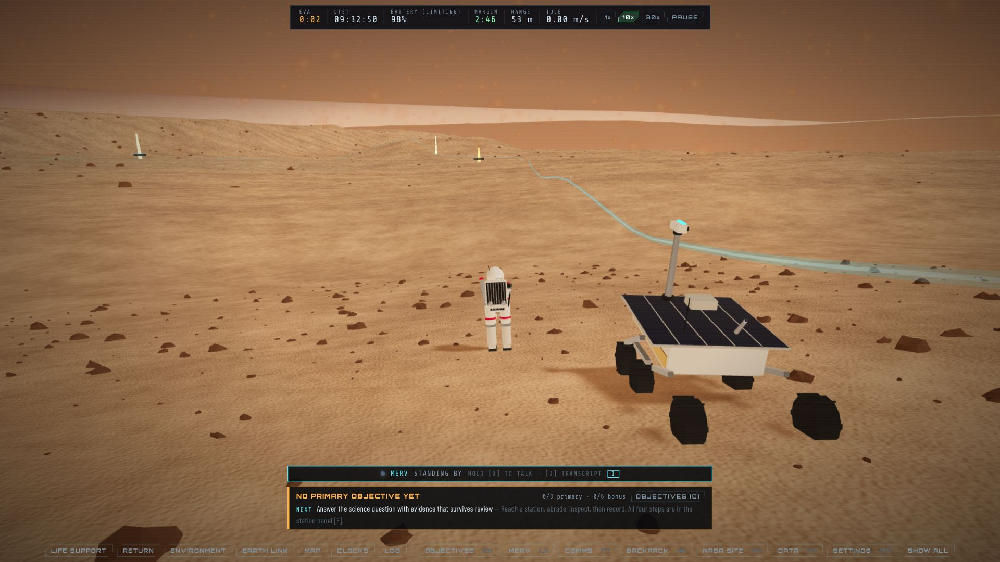](https://www.crimsonexodus.us/)

*A route across Jezero. A finite life-support budget. A rover companion who knows when it is time to turn back.*

</div>

---

## The mission in 90 seconds

Crimson Exodus is a playable Mars EVA planning and field-science simulation built around NASA data. You are Jack, an astronaut at Jezero crater. Pick a traverse, manage oxygen, battery, water and CO₂ scrubbing, investigate three geological stations, send your science home through a relay orbiter, and return before your reserve runs out.

Mars is not a backdrop here. The mission clock follows Mars time, the Sun follows the local sky, dust changes visibility and solar power, and the route planner uses the same terrain and costs as the walk itself.

> **The question:** Did the Jezero delta record a long-lived lake, and could its fine-grained beds preserve organic carbon?

<div align="center">

| **Real Mars data** | **Real decisions** | **A rover with a point of view** |
|:--|:--|:--|
| HiRISE elevation, Mars Trek imagery, CRISM and Perseverance locations | Range, slope, weather, science time and return margin all compete | MERV answers from sourced knowledge and live suit telemetry |

</div>

## Take a look around

The screenshots below are captures from the running app. Open any image to see it full size. The full set is in [`docs/screenshots`](docs/screenshots/README.md).

<table>
<tr>
<td width="50%"><a href="docs/screenshots/04-planner.jpg">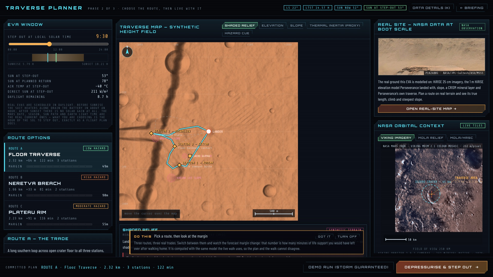</a><br /><b>01 · Pick your route</b><br />Compare distance, elevation gain, station coverage and the return budget.</td>
<td width="50%"><a href="docs/screenshots/05-real-site-nasa-data.jpg">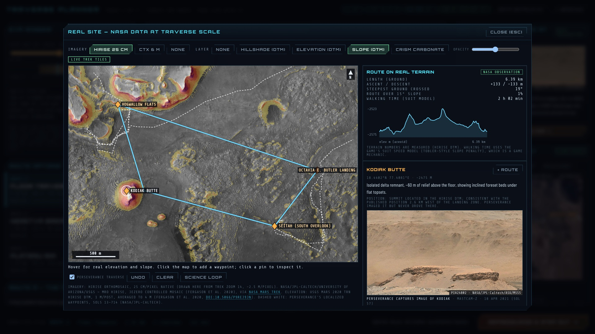</a><br /><b>02 · Walk on real data</b><br />Explore HiRISE terrain, NASA imagery, CRISM and Perseverance's traverse.</td>
</tr>
<tr>
<td><a href="docs/screenshots/09-procedure-result-nasa-image.jpg"></a><br /><b>03 · Do the field work</b><br />Animated procedures spend mission time and return a science result.</td>
<td><a href="docs/screenshots/12-dust-storm.jpg">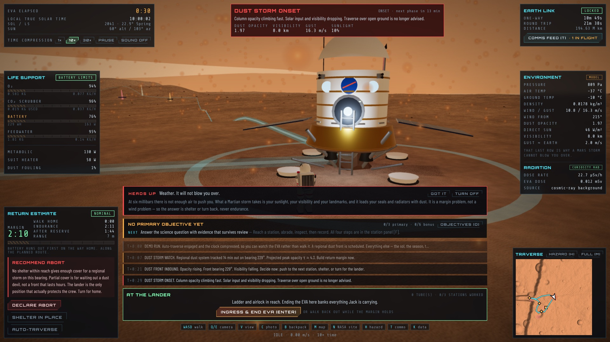</a><br /><b>04 · Read the weather</b><br />Dust steals visibility and power while the clock keeps moving.</td>
</tr>
<tr>
<td><a href="docs/screenshots/15-merv-comms-sourced.jpg">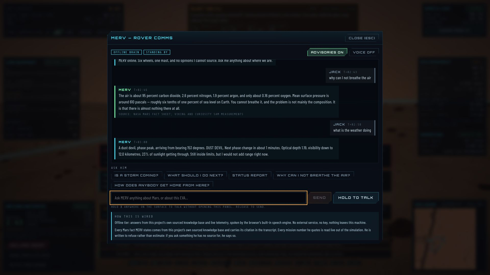</a><br /><b>05 · Ask MERV</b><br />A sourced Mars guide, telemetry-aware EVA advice, and optional Deepgram speech.</td>
<td><a href="docs/screenshots/13-debrief.jpg">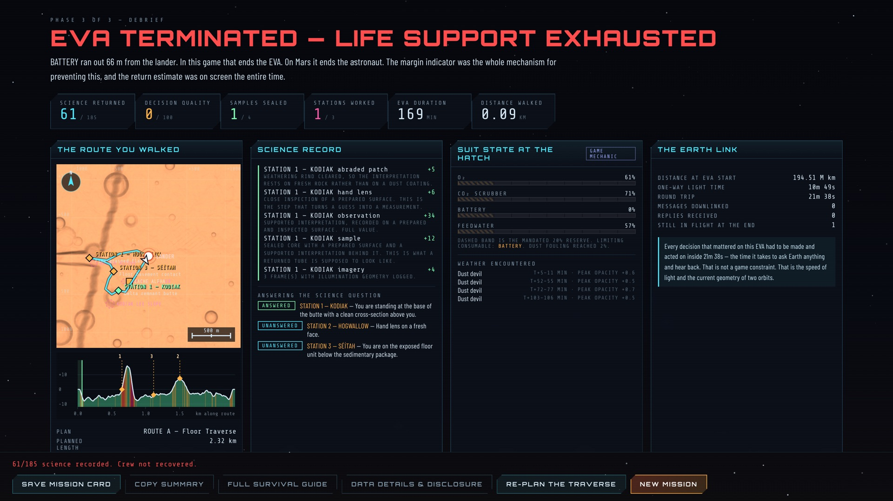</a><br /><b>06 · Bring the story home</b><br />Review the outcome, evidence, decisions and survival lessons.</td>
</tr>
</table>

### From the real Jezero

The app's NASA photographs are real mission images, not generated scenery. A selection is bundled locally and credited in the interface.

<div align="center">

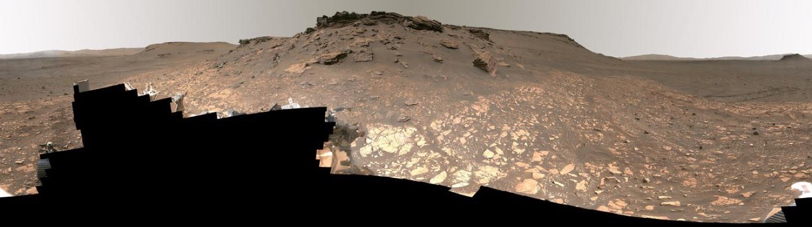

*Jezero delta panorama · NASA/JPL-Caltech*

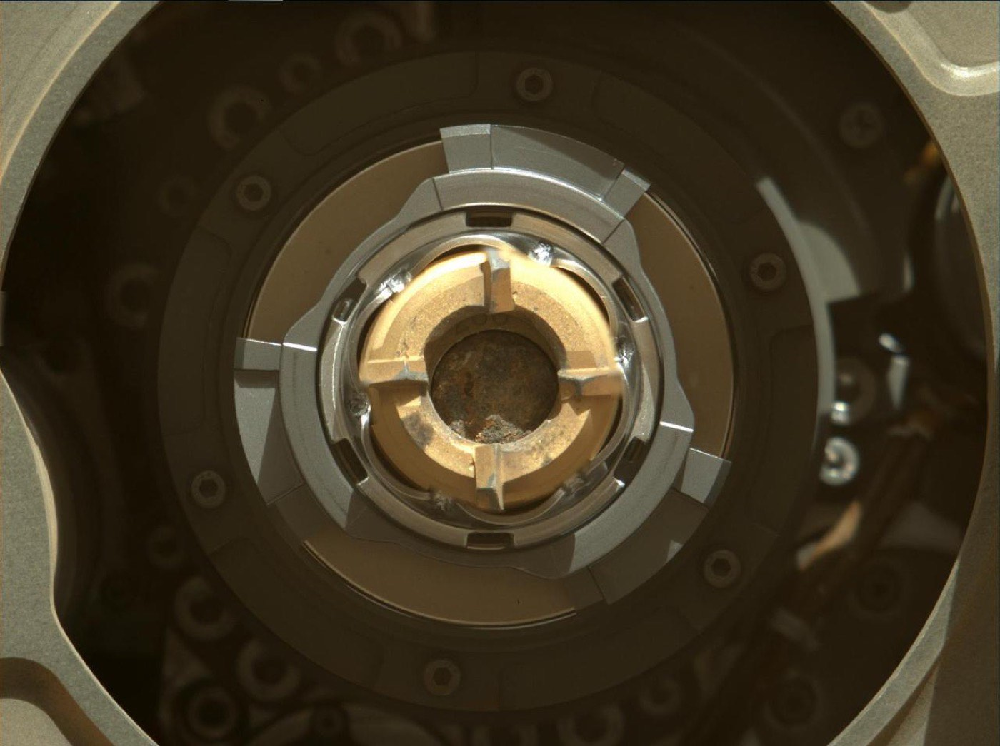
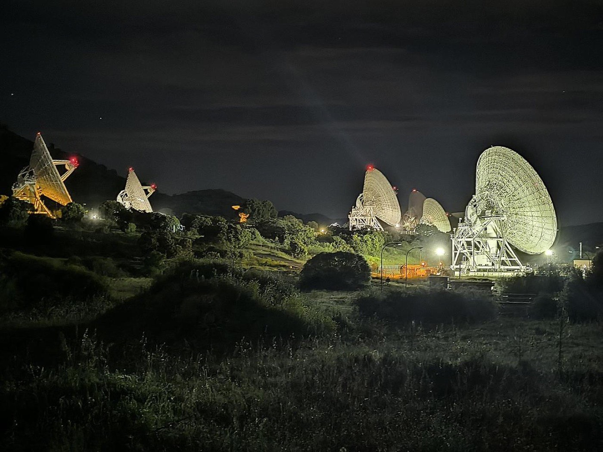

*A core ready for science · NASA/JPL-Caltech* &nbsp;&nbsp; *The signal's long way home · NASA/JPL-Caltech*

</div>

**Video note:** there is no recorded gameplay video in the repository. The animated screenshot reel below is assembled from the app captures, and the live mission is linked above.

<div align="center">

[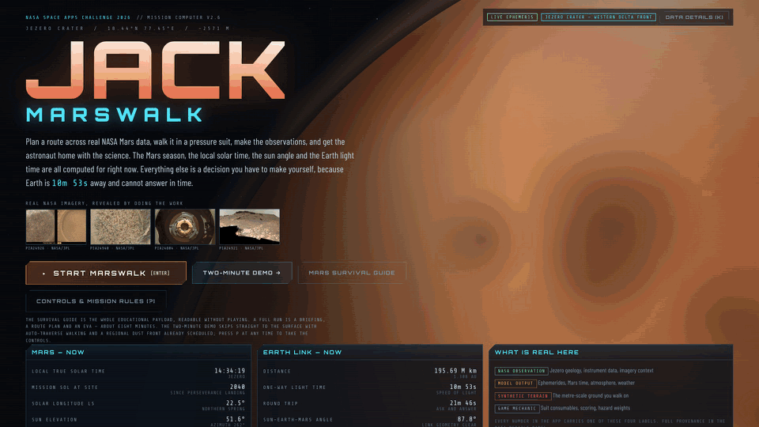](docs/crimson-exodus-screenshot-reel.gif)

*A short animated reel made from all 17 application screenshots. This is a screenshot tour, not a recorded gameplay video.*

</div>

<details>
<summary>Open the complete 17-image app gallery</summary>

<div align="center">

<a href="docs/screenshots/01-title.jpg">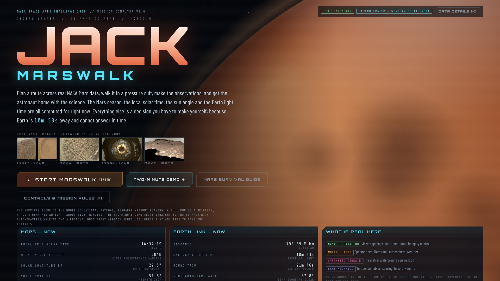</a>
<a href="docs/screenshots/02-survival-guide.jpg">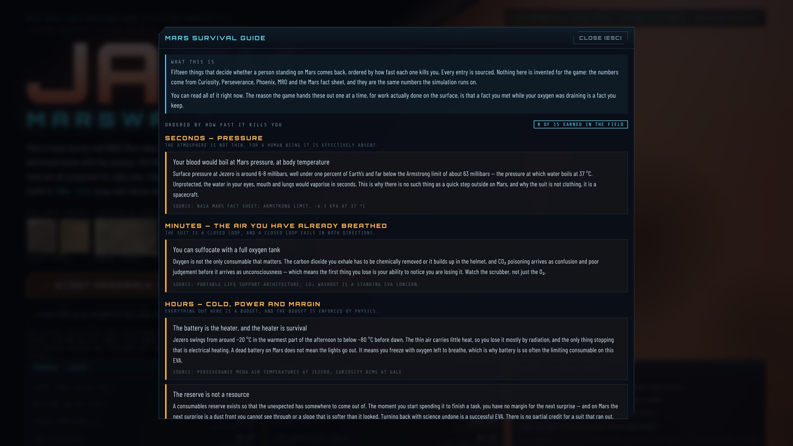</a>
<a href="docs/screenshots/03-briefing.jpg">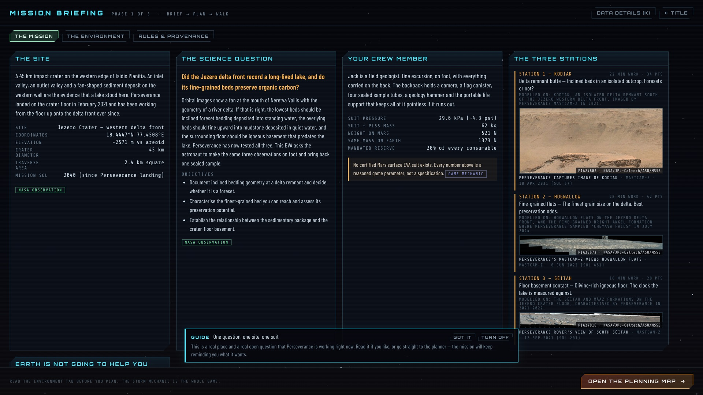</a>
<a href="docs/screenshots/06-surface-traverse.jpg"></a>
<a href="docs/screenshots/07-objectives.jpg">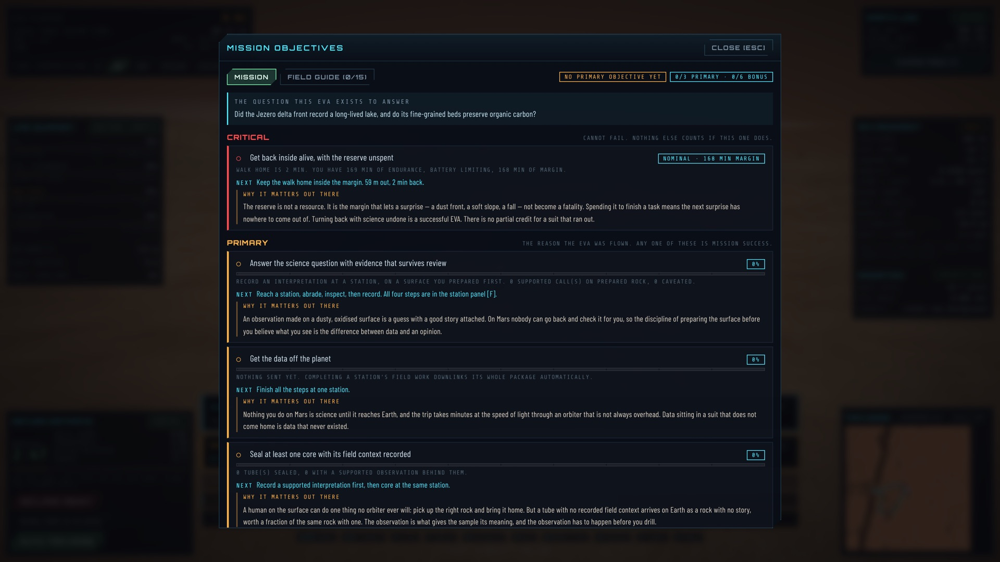</a>
<a href="docs/screenshots/08-procedure-running.jpg">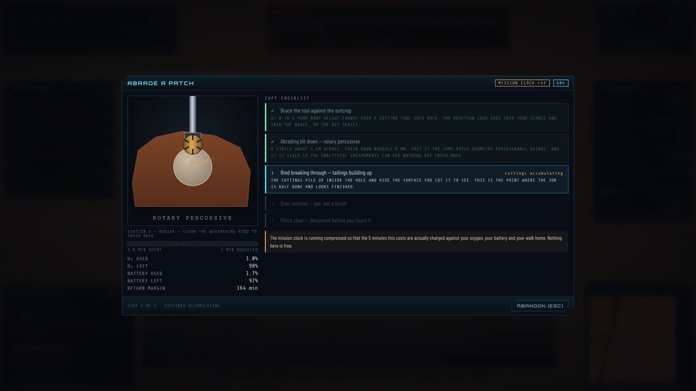</a>
<a href="docs/screenshots/10-downlink-to-earth.jpg">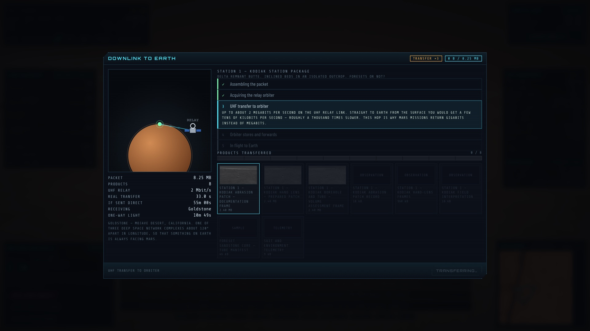</a>
<a href="docs/screenshots/11-nasa-feed.jpg">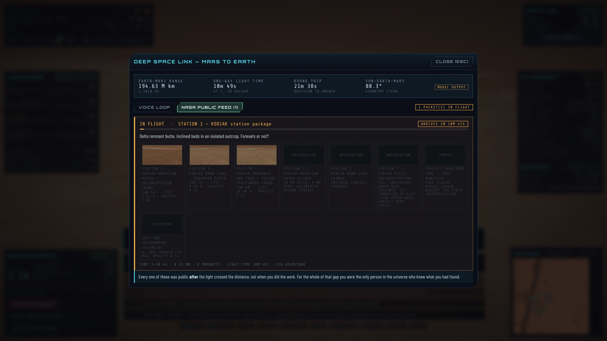</a>
<a href="docs/screenshots/14-merv-rover-companion.jpg">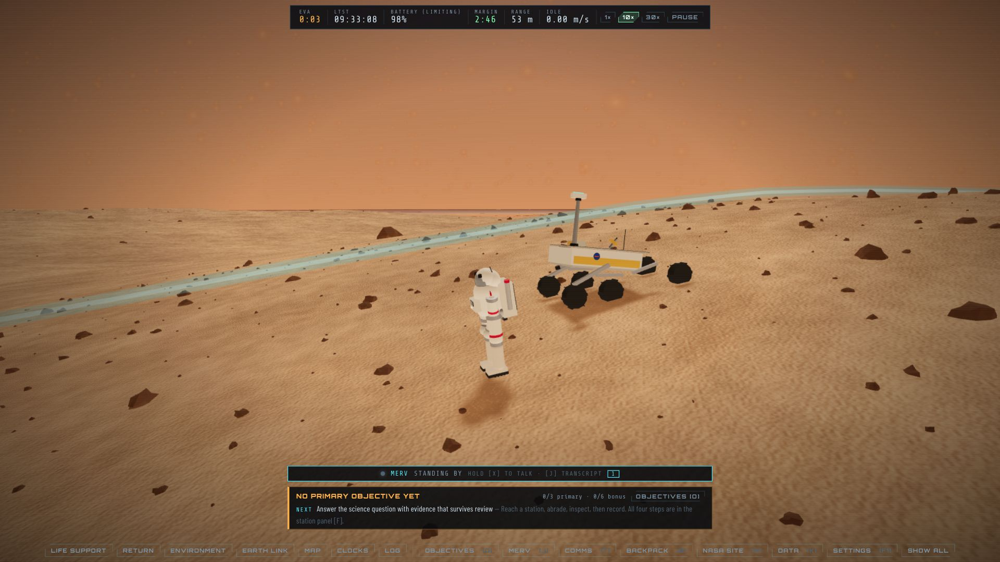</a>
<a href="docs/screenshots/16-merv-unprompted-warning.jpg"></a>
<a href="docs/screenshots/17-hud-windows.jpg">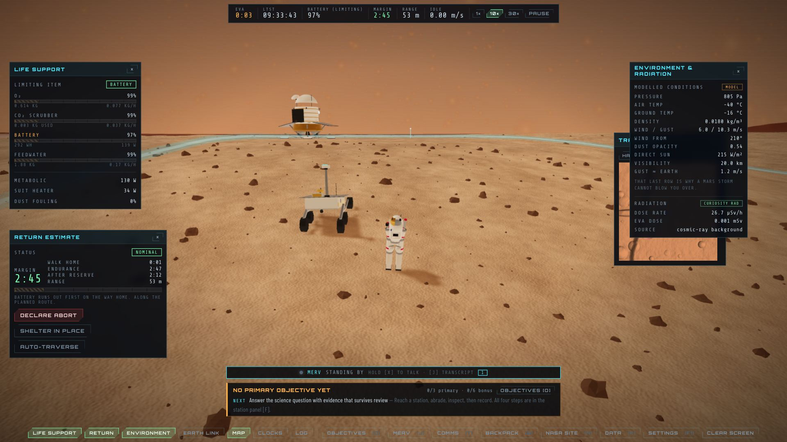</a>

</div>

</details>

## Play

Open the [live mission](https://www.crimsonexodus.us/) or run it locally:

```bash
npm install
npm run dev
```

On the title screen, press **Enter** to begin. Press **?** for controls and mission rules. No account, API key or server is needed for the complete single-player experience.

### Controls

| Key | Action | Key | Action |
|:--|:--|:--|:--|
| `W A S D` / arrows | Walk | `F` | Work the station in reach |
| `Q` / `E`, mouse drag | Look around | `C` | Capture a science frame |
| Mouse wheel | Camera distance | `G` | Plant a flag |
| `Shift` | Time-compression boost | `N` | NASA real-site map |
| `M` | Mission map | `T` | Earth communications |
| `X` (hold) | Talk to MERV | `J` | MERV transcript and questions |
| `H` | Hazard overlay | `O` | Objectives and field guide |
| `R` | Swap supplies at a depot | `Enter` | Ingress and end the EVA |
| `Space` | Pause | `Esc` | Close a panel |

The mission's life-support, return, environment, Earth-link, map and log panels open from the HUD dock. The status bar keeps the EVA clock, limiting consumable, return margin and range visible.

## What makes the EVA a mission

### Plan against the return

Three routes trade distance, climb, station coverage and exposure. The planner's sampled route is reused by the 3D trail, elevation profile, hazard map, walking cost and live return estimate. Changing the route changes the actual mission.

| Traverse | Distance | Climb | Stations | The trade |
|:--|--:|--:|--:|:--|
| A · Floor Traverse | 2.32 km | +64 m | 3 | Full science plan, little slack if weather turns |
| B · Neretva Breach | 1.66 km | +34 m | 2 | Short and gentle, but funnels dust through a narrow corridor |
| C · Plateau Rim | 2.23 km | +91 m | 2 | Better sightlines, with a steep climb that costs more energy |

### Do science as a procedure

Abrasion, inspection, coring and ingress run as timed sequences. Each has an animated tool schematic, a cuff checklist, a real mission-time cost, and a result tied to its NASA reference image. Leaving part-way still costs the time, but does not pretend the work was completed.

Captured frames retain their station, Sun angle, local solar time and dust opacity. They are packaged and downlinked over UHF to a relay orbiter, then over X-band to the Deep Space Network. The first hop transfers; the second waits for light to cross the real Earth–Mars distance.

### Respond to the planet

Dust devils, regional storms, low Sun, radiation events and terrain affect what you can see and how much power remains. The storm model treats wind as a visibility, solar-input and thermal problem: Mars's thin atmosphere does not push like Earth's, but dust can still erase your margin.

MERV gives unprompted warnings when the solar-particle monitor, return reserve, storm front, scrubber, visibility or rover array calls for attention. Warnings are rate-limited against real time, so time compression does not turn him into a constant alarm.

## Meet MERV

MERV is a six-wheeled scout rover and a practical companion. His offline brain is handwritten and sourced. Ask about Mars and he answers from the repository's knowledge base. Ask about this EVA and he reads the live telemetry, calculates the walk home and names the limiting suit resource. When he does not have a source, he says so.

| Mode | Speech in | How answers are made | Speech out |
|:--|:--|:--|:--|
| **Local** · default | Browser speech input, where available | Sourced knowledge base + live mission telemetry | On-device browser speech |
| **Grounded** · optional | Deepgram Nova | Same local brain; facts remain sourceable | Deepgram Aura |
| **Agent** · explicit opt-in | Deepgram | Hosted language model with live telemetry and simulation functions | Deepgram Aura |

Deepgram is optional. The offline mode works without a key or network. For Render, set a server-side `DEEPGRAM_API_KEY` with **at least Member permissions**; never expose it in a `VITE_` variable. The app exchanges it for a short-lived token at `/api/deepgram-token`. The hosted `agent` tier is never selected automatically.

<details>
<summary>Set up Deepgram locally or on a deployment</summary>

Create `.env.local` for local development:

```dotenv
VITE_ROVER_MODE=grounded
VITE_DEEPGRAM_TOKEN_URL=/api/deepgram-token
```

For Render, configure `DEEPGRAM_API_KEY` in the service's environment settings and redeploy. The key used for token grants must have at least **Member** permissions in Deepgram. Vercel and Netlify token-function implementations are also included in `api/` and `netlify/functions/`.

`VITE_DEEPGRAM_API_KEY` is only accepted on local development hosts. A `VITE_` value is public in the built JavaScript and must never hold a production secret.

</details>

## The science site

**Jezero crater** · 18.4447° N, 77.4508° E · −2571 m. A 45 km impact crater with inlet and outlet valleys and a fan-shaped delta deposit. The three field stations reflect real Perseverance targets:

| Station | Real feature | Field question |
|:--|:--|:--|
| 1 · Kodiak | Isolated delta remnant butte | Do inclined foresets truncated by flat topsets record standing water? |
| 2 · Hogwallow | Fine-grained delta-front beds, including the Bright Angel formation | Could low-permeability sediment preserve organic material? |
| 3 · Séítah | Olivine-rich igneous floor | What age bracket does the volcanic basement place on the lake? |

### Data provenance

- **Elevation:** a 1 m/post USGS Mars 2020 HiRISE DTM, averaged to 4 m for the local terrain window. It drives the elevation, slope and route profile layers.
- **Imagery:** 25 cm HiRISE and 6 m CTX Jezero orthomosaics from NASA Mars Trek; global basemaps from NASA Mars Trek WMTS.
- **Spectral data:** CRISM observation FRT00005C5E, positioned using its PDS map projection.
- **Rover context:** Perseverance traverse and real landing site, Kodiak, Séítah and Hogwallow Flats locations.
- **Radiation:** Curiosity RAD background and the May 2024 solar-particle event, with the in-game event scaled for play.
- **Mars time and geometry:** Mars24 timekeeping and JPL approximate planetary positions for season, solar time and one-way light delay.
- **Environment:** MEDA-anchored ranges for temperature, pressure, wind and dust opacity. This is a parameterised climatology, not a forecast or live telemetry.

### What is simulated

The walkable metre-scale terrain is procedural and shaped to Jezero's published morphology; it is not a boot-scale NASA DEM. Suit capacities, consumption rates, hazard weights and scoring are game mechanics. The reasoning uses physical models, but the suit is not certified and the absolute values are tuned for play.

> **Educational prototype only.** This is not an operational route planner or a safety system for real astronauts. Even high-resolution orbital imagery cannot certify a human boot placement.

## Multiplayer

Optional co-op runs through the Render WebSocket service. **EV-1** owns mission time, science procedures, shared life support and the outcome. **EV-2** walks the same surface independently. Up to three additional crew join as **HABCOM** and can send `GO`, `HOLD` and `RETURN` recommendations. A room holds five. There are no accounts; a temporary per-tab identity supports reconnects.

The game remains a complete single-player experience if the service is unavailable. Render serves the app, `/ws`, `/health` and the optional `/api/deepgram-token` endpoint from one service.

## Run and verify

Requirements: Node.js 22.

```bash
npm ci
npm run dev
```

Production preview:

```bash
npm run build
npm run preview
```

Full project checks:

```bash
npm run verify
```

`npm run verify` runs unit and multiplayer integration tests, TypeScript checks, a production build and the render smoke test.

### Deployment notes

- **Render:** connect the Blueprint in [`render.yaml`](render.yaml). It builds with `npm run verify` and serves the app plus multiplayer service. Add `DEEPGRAM_API_KEY` only if you want Deepgram speech.
- **Vercel / Netlify:** the repository includes their token handlers and deployment configuration. Deepgram remains optional.
- **GitHub Pages or another static host:** build and publish `dist/`. Single-player works without a server. Configure `VITE_MULTIPLAYER_URL=wss://your-service.onrender.com/ws` at build time to connect a separate Render service.

If the Render service is behind a custom domain, its same-origin multiplayer connection and token route work on that domain. `ALLOWED_ORIGINS` is for genuinely cross-origin frontends such as GitHub Pages.

## Accessibility and performance

The renderer adapts between quality tiers based on sustained frame time. Settings include HUD scale and reduced motion, which defaults to the operating system preference. Keyboard focus is visible; the title and panels scroll on narrow displays. The settings panel describes known accessibility limits.

## Built with

React 18 · TypeScript · Vite · Three.js / react-three-fiber · Zustand · NASA/JPL open data.

The astronaut, lander, rover, sky, terrain, dust and ground litter are generated by geometry and shaders at runtime. NASA images are used as NASA images, credited in the app; they are not presented as game renders.

## Repository map

```text
src/
  ai/          MERV's sourced brain, telemetry reasoning and voice tiers
  map/         Jezero data layers, NASA tiles and elevation profile
  mission/     Stations, routes, procedures, objectives and coaching
  multiplayer/ Room protocol, client and HABCOM console
  sim/         Mars time, environment, consumables, hazards and comms
  state/       Simulation, settings and MERV stores
  three/       Astronaut, rover, terrain and adaptive rendering
  ui/          Briefing, planner, HUD, procedures, guide and debrief
public/
  nasa/        Bundled, credited NASA/JPL photographs
  data/        Local DTM, CRISM browse and rover waypoints
  rover-mic-worklet.js
docs/screenshots/  Captures of the running application
server/            Render HTTP/WebSocket service
api/ netlify/      Optional short-lived Deepgram token handlers
```

More screenshots and their captions: [`docs/screenshots/README.md`](docs/screenshots/README.md).

## Team Ataman

NASA Space Apps Challenge 2026 · *Interplanetary Survival Guide: Martian Map*

| Team member | Space Apps handle |
|:--|:--|
| Rohit Rama Linga Reddy Maruri | `rohitmaruriats` |
| Aamod Paudel | `modulus12` |
| Damir Mertl | `k1lst1x` |
| Zafar Azatov | `zafarking` |

## AI use and credits

AI tools assisted with code authoring, simulation design and copy. No AI-generated images or video appear in the application. Visuals are procedural geometry, NASA imagery or public-domain flag renderings. MERV's default responses are written and sourced by the project; optional `agent` mode uses a hosted language model and is disclosed in the interface.

- **Code:** MIT; see [`LICENSE`](LICENSE).
- **NASA / JPL-Caltech:** Mars Trek tiles, Mars 2020 images and mission data; credits appear in the app and with the images.
- **Fonts:** Orbitron, Share Tech Mono and Barlow Condensed, under their respective open font licenses.
- **Flag imagery:** flagcdn.com public-domain renderings.

A flag planted in the simulation is commemorative and makes no claim of sovereignty. Article II of the 1967 Outer Space Treaty prohibits national appropriation of outer space.
